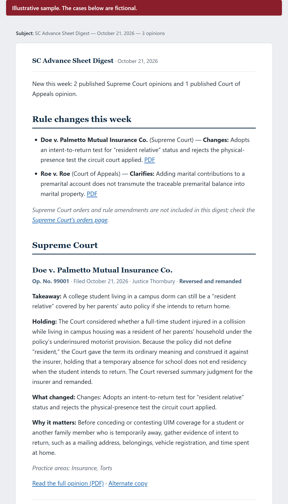

  

<h1 align="center">SC Advance Sheet Digest</h1>

  <strong>Know what South Carolina’s appellate courts decided this week.</strong> 
  A free weekly email that summarizes every newly published opinion of the Supreme Court of South Carolina
  and the South Carolina Court of Appeals, written for practicing attorneys.

  <a href="https://cappuccino4.github.io/SCStateSupremeCourt/"><picture><source media="(prefers-color-scheme: dark)" srcset="https://img.shields.io/badge/Subscribe-f8f5ee?style=for-the-badge"></picture></a> 
  Free. Usually one email a week. Unsubscribe anytime.

  <a href="#sample-issue">Sample issue</a> ·
  <a href="#what-each-issue-contains">What each issue contains</a> ·
  <a href="#how-the-summaries-are-made">How the summaries are made</a> ·
  <a href="#faq">FAQ</a>

## At a glance

<table>
  <tr><th align="left">Cost</th><td>Free</td></tr>
  <tr><th align="left">Covers</th><td>Every newly published opinion of the Supreme Court of South Carolina and the South Carolina Court of Appeals</td></tr>
  <tr><th align="left">Not included</th><td>Unpublished opinions; Supreme Court orders, including rule amendments</td></tr>
  <tr><th align="left">When it arrives</th><td>Usually one email a week, on Wednesday afternoon (Eastern); occasionally a short Thursday supplement; no email in a week with nothing new</td></tr>
  <tr><th align="left">Format</th><td>Rule changes first, then an AI-written summary of each opinion, with a link to the full opinion</td></tr>
  <tr><th align="left">Signing up</th><td>Enter your email on the <a href="https://cappuccino4.github.io/SCStateSupremeCourt/">signup page</a>, then click the confirmation link Buttondown emails you. Buttondown, which sends the digest, stores your address only to send it.</td></tr>
  <tr><th align="left">Unsubscribing</th><td>A link at the bottom of every email</td></tr>
</table>

## Sample issue

  

  <strong>Illustrative sample.</strong> The cases shown are fictional. A complete sample issue is on the <a href="https://cappuccino4.github.io/SCStateSupremeCourt/#sample">signup page</a>.

## What each issue contains

Every issue follows the same order. Its subject line gives the date and the number of opinions, as in *SC Advance Sheet Digest — October 21, 2026 — 3 opinions*.

1. **Rule changes this week.** Each opinion that changes or clarifies a rule, with a one-line note and a PDF link, or a line saying none did. Any opinion that couldn’t be summarized is named here as not checked for rule changes.
2. **Supreme Court**, then **Court of Appeals.** One entry per opinion:
    - Case name, opinion number, filing date, author, and disposition
    - **Takeaway:** the practical point, in one sentence
    - **Holding:** the question decided, the rule applied, and the result, in two to four sentences
    - **What changed:** whether the opinion *changes*, *clarifies*, or *reaffirms* the law, and how; or “No change to existing law.”
    - **Why it matters:** a practice tip for South Carolina practitioners
    - **Practice areas:** short labels, such as Insurance, Criminal, or Family
    - A link to the full opinion, plus an alternate copy when there is one
3. **Footer.** The disclaimer, the sources, and an unsubscribe link.

## How the summaries are made

1. **Collected.** Opinions published by the South Carolina Judicial Branch are collected through [CourtListener](https://www.courtlistener.com/), a free legal-research service of the nonprofit [Free Law Project](https://free.law/).
2. **Summarized.** Claude (claude-sonnet-5-5), the AI model made by [Anthropic](https://www.anthropic.com/), reads each opinion’s own text and writes a structured summary. It is instructed to use only that text, with no outside knowledge; to cite only authorities the opinion itself cites; and to write “unclear from the opinion” rather than guess. Each issue’s footer names the model, and the instructions it is given are public in [`src/summarize.py`](src/summarize.py).
3. **Delivered.** The summaries are assembled into an issue and sent through [Buttondown](https://buttondown.com/).

In each entry:

- **From the court, not the AI:** the case name, opinion number, court, filing date, and author, whenever the court’s record or the opinion PDF gives them.
- **The AI’s reading:** the disposition and the summary itself, including whether the opinion is listed under “Rule changes this week”.
- **Long opinions** are shortened first, and the entry says how much of the text the summary is based on.
- **If a summary can’t be made,** the opinion is still listed with its link.

## FAQ

<strong>Does “Rule changes this week” include amendments to the court rules?</strong>

No. It lists opinions that change or clarify a rule of law. Supreme Court orders, including rule amendments, are not included; each issue says so and links to the <a href="https://www.sccourts.org/opinions-orders/court-orders/all-court-orders/">Supreme Court’s orders page</a>.

<strong>How accurate are the summaries?</strong>

They are a starting point, not an authority. Claude is instructed to work only from the opinion’s text and to write “unclear from the opinion” rather than guess, but AI-generated summaries can still contain errors or omissions. Treat each one as a guide to the opinion, never a substitute for reading it.

<strong>Why did I get a second email this week?</strong>

When an opinion is posted late or a summary wasn’t ready in time, a short supplement follows on Thursday. Its subject ends in “(supplement)”; it names the week’s earlier issue and lists only what it adds.

## Disclaimer

> [!IMPORTANT]
> **AI-generated summaries for informational purposes only; not legal advice; always read the full opinion.**
>
> Summaries may contain errors or omissions, and opinions can be revised, withdrawn, or reheard after publication. Reading the digest creates no attorney-client relationship. SC Advance Sheet Digest is an independent publication: it is not affiliated with or endorsed by the South Carolina Judicial Branch, Free Law Project, or Anthropic, and it is not the Judicial Branch’s official Advance Sheets. Official opinions are at [sccourts.org](https://www.sccourts.org/).

## Running your own copy?

This repository also holds the code that produces the digest. It runs on GitHub Actions, CourtListener, the Claude API, Buttondown, and GitHub Pages. The operating guide, [OPERATING.md](OPERATING.md), covers [setup in 13 steps](OPERATING.md#setup-step-by-step), [costs](OPERATING.md#model-and-cost-plan) (about $1–2 a month of Claude API usage), [configuration](OPERATING.md#configuration-reference), and [maintenance](OPERATING.md#maintenance-cheat-sheet).

---

   
  <a href="https://cappuccino4.github.io/SCStateSupremeCourt/">Subscribe</a> · <a href="#disclaimer">Disclaimer</a> · <a href="OPERATING.md">Operating guide</a>

